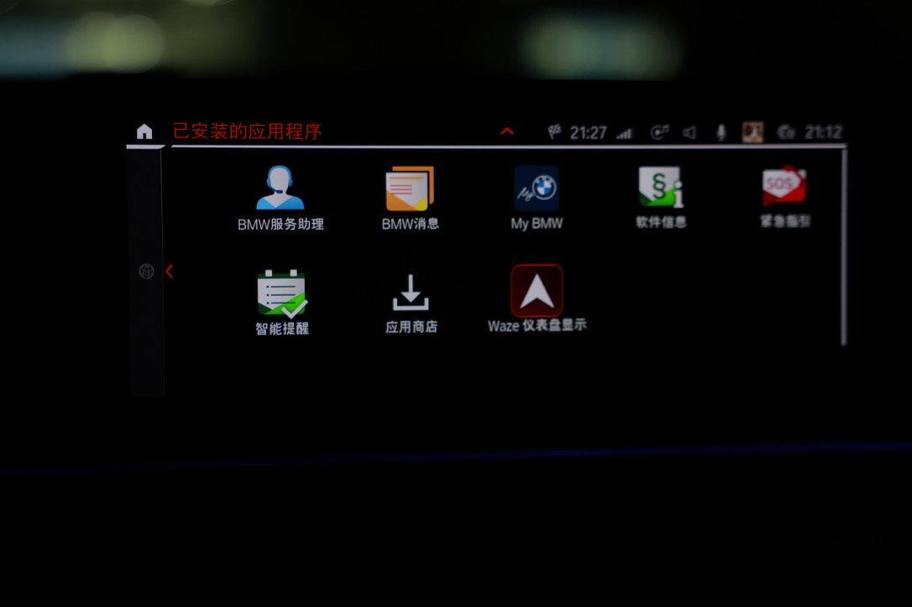
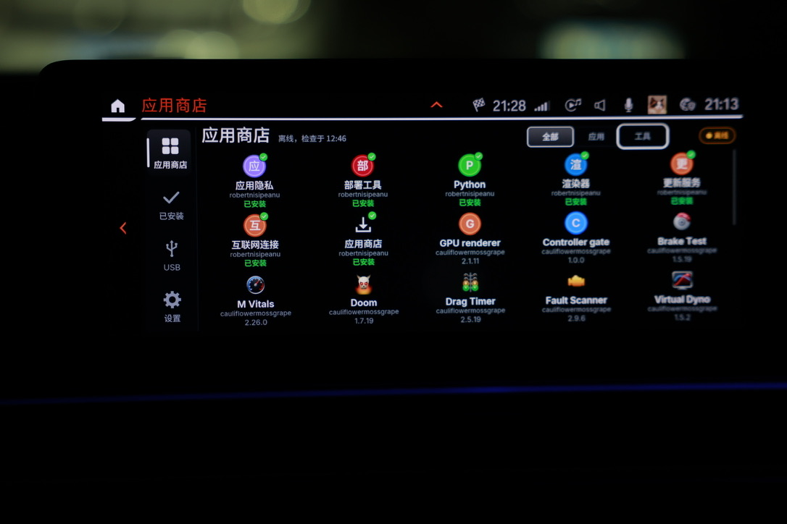
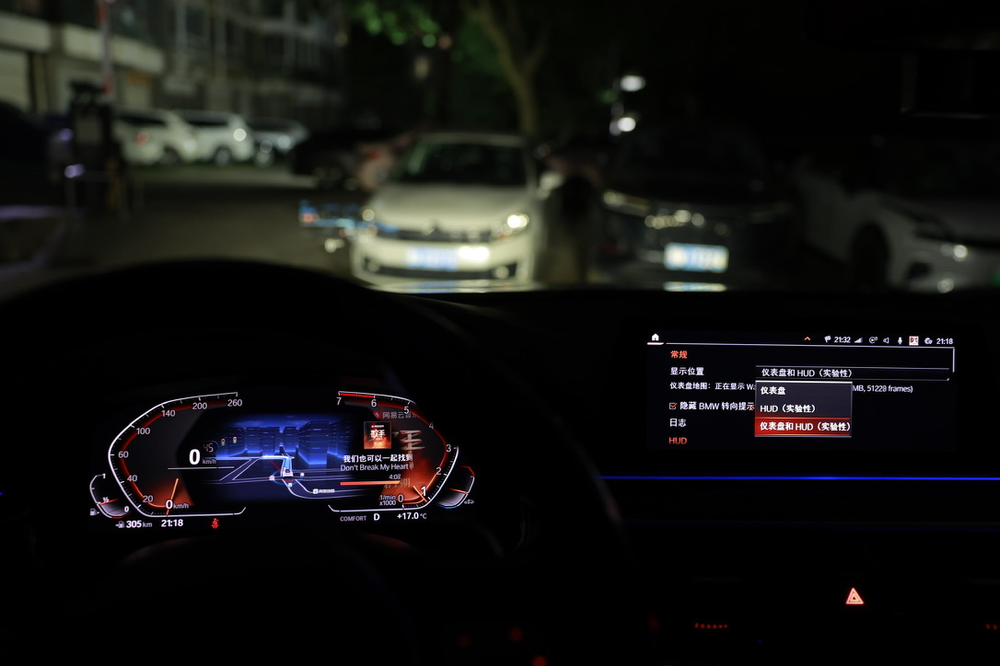

# MGU Setup Skills

[简体中文](README.zh-CN.md)

[](https://github.com/Wallezy/mgu-setup-skills/actions/workflows/validate.yml)
[](LICENSE)

A bilingual agent skill for owner-authorized BMW MGU setup and maintenance: environment checks, backup preparation, initial root SSH, Store installation, map/HUD setup, updates and supported recovery.

The skill guides an agent to **perform authorized work with upstream tools**, inspect the result and produce a session record. It is not a firmware flasher or a promise of automatic recovery from every failure.

## On the owner's iDrive 7

| App entries | Store |
| --- | --- |
|  |  |
| **Cluster and HUD settings** | **HUD map output** |
|  |  |

Photos supplied by the owner show one iDrive 7 installation, including actual
HUD output. They do not establish compatibility or frame rate for other cars,
phones or map apps. HUD remains experimental. [Full-size gallery / 实车效果图](docs/SHOWCASE.md).

## Use

1. Get this repository using **Code → Download ZIP**, or clone it:

   ```sh
   git clone https://github.com/Wallezy/mgu-setup-skills.git
   cd mgu-setup-skills
   ```

2. Give your agent the absolute path to `skills/mgu-setup/SKILL.md`, or install the complete skill folder as described below.
3. Start with an environment check and the specific operation you want. Keep the car disconnected if you only want preparation.

Copy the complete [`skills/mgu-setup`](skills/mgu-setup) directory into your agent's skill directory, keeping references and scripts together. Tools that read a local skill directly can use the absolute path to `skills/mgu-setup/SKILL.md`.

Your agent needs local file access and command execution to perform installation; a chat-only assistant can explain the procedure but cannot operate the computer. Skill folder locations and invocation syntax depend on the host tool.

> Use $mgu-setup to inspect my computer and connected head unit, prepare backups, and install root SSH, the official Store and the map/HUD app. Reuse working access and verify each completed stage.

Other supported requests:

- “The Store disappeared. Diagnose and restore its entry.”
- “Update only the Store and map app, preserving my settings.”
- “Inspect the boot loop and identify a supported rollback.”
- “Remove the map patch and app; retain the Store.”
- “Prepare offline resources now; the car is not connected.”

The agent should execute within the request's scope, not just print a tutorial. Physical display checks and coding-tool operations may still need the owner. Installing this skill does not authorize vehicle writes.

## Preparation order

For planned setup or updates, the skill requires **local environment check → local resource download and verification → read-only vehicle identification and backup checks → readiness decision → vehicle writes → result verification**.

The agent stages only the requested tools/packages and their dependencies outside the repository, records versions and hashes, and reuses verified cached files. Vehicle identification can happen earlier when needed to select the correct architecture. Missing dependencies, resources or required backups block the corresponding write.

The environment helper reports problems; the agent prepares missing dependencies in the chosen environment and checks again. This is an agent workflow, not a standalone automatic flasher. Local packages reach the HU through official bootstrap transfer or supported Store/USB/update paths; copying files to the computer alone does not make the car offline-ready. Read-only diagnosis and recovery do not require downloading unrelated apps.

## Coverage

| Task | Behavior |
|---|---|
| Environment and connection | Check runtimes, ENET interface, routing, identity and existing SSH |
| Backup preparation | Separate coding, credentials, deployment snapshots and patch originals |
| Initial root | Use current upstream first-time setup only when needed |
| Store setup and repair | Official installer; registry/tile checks for missing entries |
| Maps and HUD | Install dependencies; configure through the app; verify actual output |
| Updates | Published releases, dependency resolution and post-start verification |
| Downgrade/rollback | Check retained versions and compatibility; use supported paths only |
| Restore/remove | Separate patch removal, component removal, Store removal and SSH removal |
| Failure diagnosis | Network, authentication, coding, missing tiles and startup failures |
| Handoff | Record versions, checks, temporary settings and remaining owner actions |

## Official and domestic sources

One skill supports `upstream-first` (official GitHub), `domestic-first`
(Gitee source and OSS packages), and `auto` (official catalogs first, then
configured OSS). Location is not inferred from language or IP. Fallback
preserves selected versions and hashes.

The configured OSS snapshot passed public HTTPS download and hash acceptance
on November 7, 2026; see the [validation record](VALIDATION.md). The shared
default remains `auto`; users can save `domestic-first` as their preference.
The [Gitee skill mirror](https://gitee.com/walle7/mgu-setup-skills),
[source configuration](skills/mgu-setup/references/network-sources.json),
[mirror maintenance guide](docs/DOMESTIC-MIRROR.md) and standalone
[source workflow](skills/mgu-setup/references/network-mirrors.md) describe
the two download paths.

## Platforms and evidence

Upstream source workflows target Windows, macOS and Linux. Source SSH setup requires Python 3.9+, `cryptography` and OpenSSH. Direct Store installation uses Node.js 18+ and OpenSSH; current upstream wrappers offer runtime preparation, so inspect requirements before choosing a route.

**The recorded vehicle experience is macOS + ENET + iDrive 7.** Windows, Linux and iDrive 8 are upstream-supported targets, not hardware-tested here. HUD is experimental upstream; background checks do not prove visual output on every car.

Local checks only, with no vehicle or network access:

```sh
python3 skills/mgu-setup/scripts/check_environment.py --json
```

On Windows select the intended Python, for example `py -3`. A passing report is not vehicle compatibility or flash readiness.

Use `--profile store` for direct Store installation prerequisites, `--profile root` for source SSH prerequisites, or `--profile inspect` for preparation only. Exit code 1 means required local checks are missing or unverified; it does not mean a vehicle operation failed. The script never installs missing dependencies.

## Documentation

- [FAQ](docs/FAQ.md): prerequisites, offline use, root persistence and recovery boundaries.
- [Skill entrypoint](skills/mgu-setup/SKILL.md).
- [English workflow](skills/mgu-setup/references/workflow.en.md) / [中文流程](skills/mgu-setup/references/workflow.zh-CN.md).
- [Recovery decisions / 恢复判断](skills/mgu-setup/references/recovery.md).
- [Evidence and sources / 经验与来源](skills/mgu-setup/references/evidence.md).
- [Session record / 会话记录](skills/mgu-setup/references/session-record.md).
- [Validation scenarios / 验证场景](VALIDATION.md).
- [Contributing](CONTRIBUTING.md): translations, tests and sanitized compatibility reports.
- [Photos / 实车效果图](docs/SHOWCASE.md): app entries, Store, cluster and HUD.
- [Domestic mirrors / 国内镜像](docs/DOMESTIC-MIRROR.md): source preferences, preparation and OSS publishing.

## Upstream projects

This project coordinates existing tools and documents practical experience. It is an independent community project, not a BMW product or a replacement for upstream software:

- [idrive7-8-ssh-root](https://github.com/cauliflowermossgrape/idrive7-8-ssh-root): initial SSH access.
- [mgu-store](https://github.com/robertnisipeanu/mgu-store): Store, official installer and updater.
- [idrive-apps](https://github.com/robertnisipeanu/idrive-apps): map application and cluster/HUD components.

Report skill instructions, translations and helper defects [here](https://github.com/Wallezy/mgu-setup-skills/issues/new/choose). For an upstream software defect, identify the responsible component and link the upstream issue instead of assuming the skill can repair it.

## WeChat contact

Connect with Walle to discuss MGU setup and usage. Scan the image below with
WeChat to get in touch; please mention “MGU”.


[Full-size image](skills/mgu-setup/assets/wechat-code.png) · [Contact details](skills/mgu-setup/references/contact.md)

## Development

No additional Python packages are required for repository validation:

```sh
python3 tools/check_repository.py
python3 -m unittest discover -s tests -v
python3 tools/package_skill.py
```

Packaging produces `dist/mgu-setup.zip` and `dist/SHA256SUMS`. The archive includes the complete skill and GPL license; it does not contain downloaded vehicle resources. CI checks the helper and documentation on Windows, macOS and Linux. These are software checks, not vehicle tests.

No firmware, BMW SDK, root keys, VINs or vehicle logs are distributed here. Keep session data outside the repository. Publishing private evidence requires redaction and owner authorization.

Before advertising another platform or head unit as tested, contribute sanitized environment details, exact versions, observed results and recovery limitations. Documentation/helper checks do not replace hardware validation.

## License

Original repository content is licensed under **GNU GPL version 3 only** (`GPL-3.0-only`). See [LICENSE](LICENSE). The standalone skill carries the same license and its [notice](skills/mgu-setup/NOTICE.md). Referenced or downloaded third-party tools, firmware and resources retain their respective licenses; they are not relicensed by this repository.
