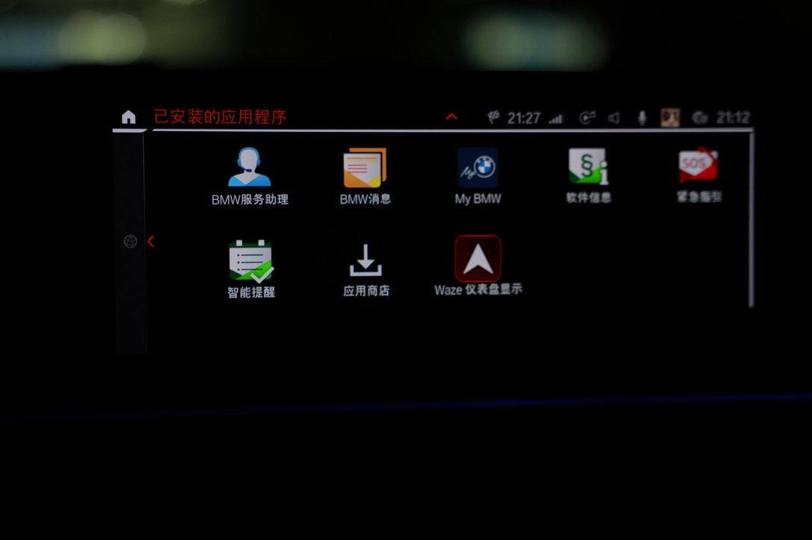
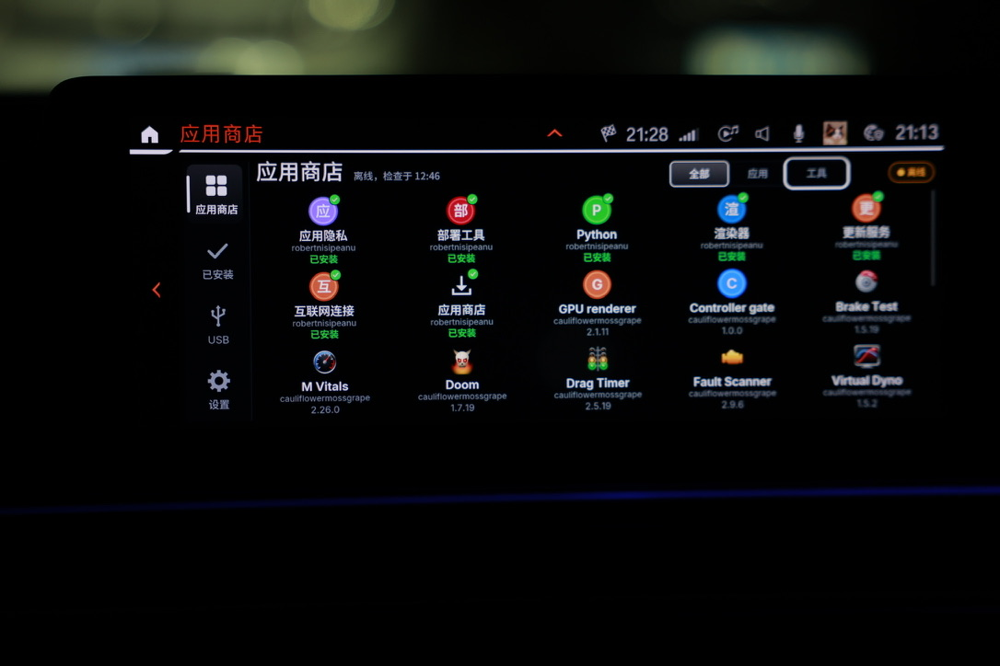

# MGU Setup Skills

[English](README.md)

[](https://github.com/Wallezy/mgu-setup-skills/actions/workflows/validate.yml)
[](LICENSE)

面向车主授权操作的中英文 agent skill，覆盖 BMW MGU 的环境检查、备份准备、首次 root SSH、商店安装、地图/HUD 配置、更新和受支持的恢复流程。

它让 AI **调用上游工具完成已授权的工作，再检查和记录结果**。它本身不是固件刷写工具，也不承诺所有故障都能自动恢复。

## 实车效果

| 应用入口 | 应用商店 |
| --- | --- |
|  |  |
| **仪表盘与 HUD 设置** | **HUD 地图显示** |
|  |  |

以上为车主提供的同一次 iDrive 7 安装实拍，展示应用入口、商店界面、显示位置设置及 HUD 实际画面。照片不代表所有车型、手机和地图应用都能达到相同效果，也不能用于判断帧率；HUD 仍属实验性功能。[查看完整效果图](docs/SHOWCASE.md)。

## 使用方法

1. 在仓库页面选择 **Code → Download ZIP** 下载，或使用 Git：

   ```sh
   git clone https://github.com/Wallezy/mgu-setup-skills.git
   cd mgu-setup-skills
   ```

2. 将 `skills/mgu-setup/SKILL.md` 的绝对路径交给 AI，或按下面的方法安装完整文件夹。
3. 明确要求先检查环境，并说明本次要完成的操作。只准备资源时无需连接车辆。

将完整的 [`skills/mgu-setup`](skills/mgu-setup) 文件夹复制到你的 AI 工具的 skill 目录，保留引用文档和脚本。支持读取本地 skill 的工具，也可以直接指定 `skills/mgu-setup/SKILL.md` 的绝对路径。

AI 需要具备本地文件访问和命令执行能力才能实际安装；只能聊天的助手可以讲解流程，但不能操作电脑。Skill 安装目录和调用语法以所用工具为准。

> 使用 $mgu-setup，检查电脑和已连接的车机，准备备份，然后完成 root SSH、官方商店和地图/HUD 应用安装。复用已有的正常连接，逐项验证操作结果。

Root 工具的正式版本选择、本地版本校验及 Windows 发布包路径见
[Root 工具准备](skills/mgu-setup/references/root-tool.md)，当前审阅基线为 v1.3.1。

其他使用场景：

- “商店入口消失了，帮我诊断并恢复入口。”
- “只更新商店和地图应用，保留当前配置。”
- “先检查循环启动原因，判断能否回滚。”
- “撤销地图补丁并移除地图应用，保留商店。”
- “车辆还没连接，先准备离线安装资源。”
- “准备整套切换到 Walle 国内版，包含安装器和已安装组件，保留设置。”

[整套发行版切换](skills/mgu-setup/references/store-distributions.md#switch-distribution)
涵盖电脑安装器、商店、更新器、部署工具、基础依赖、已安装应用及后续更新源。
**当前国内版仅支持本地检查与准备；迁移入口已开发，尚未通过车机集成及可安装发行验收。**

AI 应在授权范围内实际操作，不应只输出教程。车机屏幕观察、编码工具备份和恢复可能仍需车主完成。安装 skill 不等于授权写入车辆。

## 准备顺序

计划安装或更新时，skill 要求按顺序完成：**检查本地环境 → 下载并校验本地资源 → 只读识别车辆及检查备份 → 判断准备是否齐全 → 写入车机 → 验证结果**。

AI 只准备本次需要的工具、安装包和依赖，保存在仓库之外，记录版本与哈希，并复用已验证的缓存。为了选对架构，可以提前只读识别车辆。环境依赖、所需资源或必要备份不齐时，不进入对应写入步骤。

环境脚本负责报告问题，AI 在选定环境中准备缺失依赖并重新检查。这是 agent 执行流程，不是单独的一键刷写程序。本地资源通过官方首次安装传输或商店/USB/更新路径交付车机；文件下载到电脑不等于车机已具备离线安装条件。只读诊断和故障恢复不要求下载无关应用。

## 官方源与国内镜像

同一份 Skill 支持 `upstream-first`（优先官方 GitHub）、`domestic-first`（优先 Gitee 源码与 OSS 资源）和 `auto`（默认先检查官方，再检查 OSS）。不根据语言或 IP 猜测用户位置。选定版本后，回退下载路径也必须保持版本和哈希一致。

国内 Skill 镜像：[Gitee / walle7/mgu-setup-skills](https://gitee.com/walle7/mgu-setup-skills)。商店、应用和 SSH 源码镜像及 OSS 根地址见 [网络源配置](skills/mgu-setup/references/network-sources.json)。当前 OSS 快照于 2026 年 11 月 7 日通过匿名 HTTPS 下载及完整哈希验收，记录见 [验证说明](VALIDATION.md)。共享配置默认保持 `auto`，国内用户可保存为 `domestic-first`。

资源准备、上传顺序和验收方法见 [国内镜像维护说明](docs/DOMESTIC-MIRROR.md)。车端后续更新源仍需通过商店界面添加，不会因为首次安装使用本地包就自动切换。

## 功能范围

| 场景 | 处理方式 |
|---|---|
| 环境与连接 | 检查运行环境、ENET 网卡、路由、车辆身份和已有 SSH |
| 备份准备 | 分别记录编码、登录凭据、部署快照和补丁原始文件 |
| 首次 root | 仅在确有必要时使用当前上游首次设置流程 |
| 商店安装与修复 | 官方安装器；入口缺失时核对注册和可见状态 |
| 地图与 HUD | 按声明安装依赖，通过应用配置，并验证实际出图 |
| 更新升级 | 正式发布版本、依赖处理、重启和启动后验证 |
| 整套发行版切换 | 准备匹配的安装器和全量组件计划；仅通过已验证发布与迁移入口执行 |
| 降级与回滚 | 检查保留版本与依赖，只执行受支持的恢复路径 |
| 撤销与卸载 | 分开处理补丁、组件、商店和 SSH |
| 故障诊断 | 区分网络、认证、编码、入口丢失和反复启动 |
| 操作交接 | 记录版本、验证、临时配置与尚需车主完成的步骤 |

## 平台与验证范围

上游源码流程面向 Windows、macOS 和 Linux。源码解锁需要 Python 3.9+、`cryptography` 和 OpenSSH；直接运行商店安装脚本还需要 Node.js 18+ 和 OpenSSH。当前上游包装安装器提供运行时准备方式，使用前应核对要求。

**记录的实车经验来自 macOS + ENET + iDrive 7。** Windows、Linux 和 iDrive 8 属于上游支持范围，尚未由本仓库完成实车验证。HUD 在上游仍标为实验性，后台检查不能证明所有车型和地图应用都能正确出图。

仅检查电脑环境，不连接车辆、不访问网络：

```sh
python3 skills/mgu-setup/scripts/check_environment.py --json
```

Windows 可使用目标 Python 环境，例如 `py -3`。检查通过不代表车辆兼容或已经具备刷写条件。

`--profile store` 检查直接安装商店所需环境，`--profile root` 检查源码解锁环境，`--profile inspect` 仅用于准备。退出码 1 表示所需本地检查有缺失或未确认，不代表车机操作失败。脚本不会自行安装依赖。

## 文档

- [常见问题](docs/FAQ.md)：环境要求、离线使用、root 持久化和恢复边界。
- [Skill 入口](skills/mgu-setup/SKILL.md)：任务分流和执行边界。
- [中文流程](skills/mgu-setup/references/workflow.zh-CN.md) / [English workflow](skills/mgu-setup/references/workflow.en.md)。
- [恢复判断](skills/mgu-setup/references/recovery.md)：权限、循环启动、降级和还原。
- [经验与来源](skills/mgu-setup/references/evidence.md)：证据、历史版本和未验证项。
- [会话记录](skills/mgu-setup/references/session-record.md)：操作前后留档。
- [验证场景](VALIDATION.md)：推广前的验证要求。
- [贡献指南](CONTRIBUTING.md)：翻译、测试和脱敏后的兼容性反馈。
- [国内镜像与 OSS](docs/DOMESTIC-MIRROR.md)：Gitee 代码同步、安装资源分发与源选择。
- [实车效果图](docs/SHOWCASE.md)：应用入口、商店、仪表盘和 HUD 实拍。

## 上游项目

本项目整理流程并调用已有工具，是独立社区项目，不是 BMW 官方产品，也不替代上游软件：

- [idrive7-8-ssh-root](https://github.com/cauliflowermossgrape/idrive7-8-ssh-root)：首次建立 SSH 访问。
- [mgu-store](https://github.com/robertnisipeanu/mgu-store)：商店、官方安装器和更新服务。
- [idrive-apps](https://github.com/robertnisipeanu/idrive-apps)：地图应用及仪表盘/HUD 组件。

Skill 指令、翻译或辅助脚本问题可在[本仓库反馈](https://github.com/Wallezy/mgu-setup-skills/issues/new/choose)。上游软件缺陷应标明对应组件并关联上游 issue，不能假定 skill 能直接修复。

## 微信联系方式

欢迎交流 MGU 安装和使用经验。微信扫一扫下方图片，联系时请备注「MGU」。


[查看原图](skills/mgu-setup/assets/wechat-code.png) · [联系方式说明](skills/mgu-setup/references/contact.md)

## 开发与打包

仓库校验不需要额外安装 Python 包：

```sh
python3 tools/check_repository.py
python3 -m unittest discover -s tests -v
python3 tools/package_skill.py
```

打包生成 `dist/mgu-setup.zip` 和 `dist/SHA256SUMS`，包含完整 skill 和 GPL 协议，不包含下载的车机资源。CI 在 Windows、macOS、Linux 上检查文档和辅助脚本；这不是各系统的实车测试。

不分发固件、BMW SDK、root 密钥、VIN 或原始车辆日志。操作资料保存在仓库之外，向社区反馈前脱敏并获得车主授权。

推广到新的系统或车型前，应补充脱敏后的环境、版本、实测结果和恢复限制。文档校验、脚本检查不能替代实车验证。

## 开源协议

本仓库原创内容采用 **GNU GPL 第 3 版，仅此版本**（`GPL-3.0-only`），完整文本见 [LICENSE](LICENSE)。独立 skill 内包含相同协议和[版权声明](skills/mgu-setup/NOTICE.md)。引用或下载的第三方工具、固件和资源保留各自许可证，不因本仓库的协议而被重新授权。
