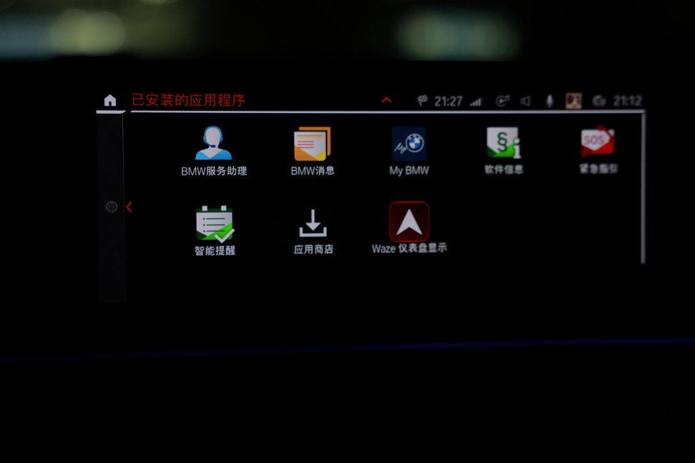
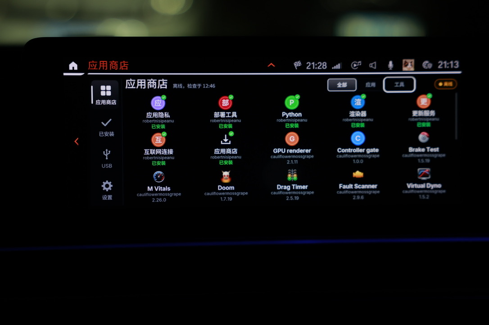
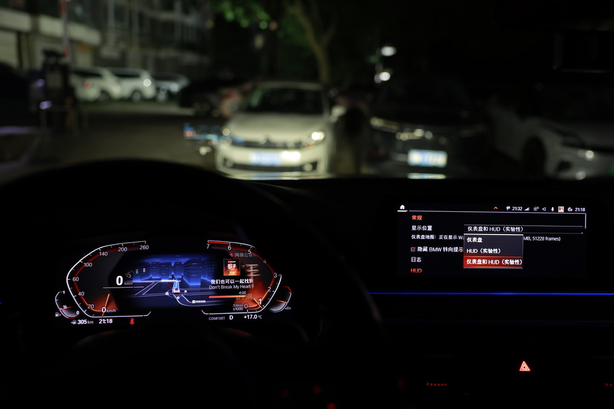
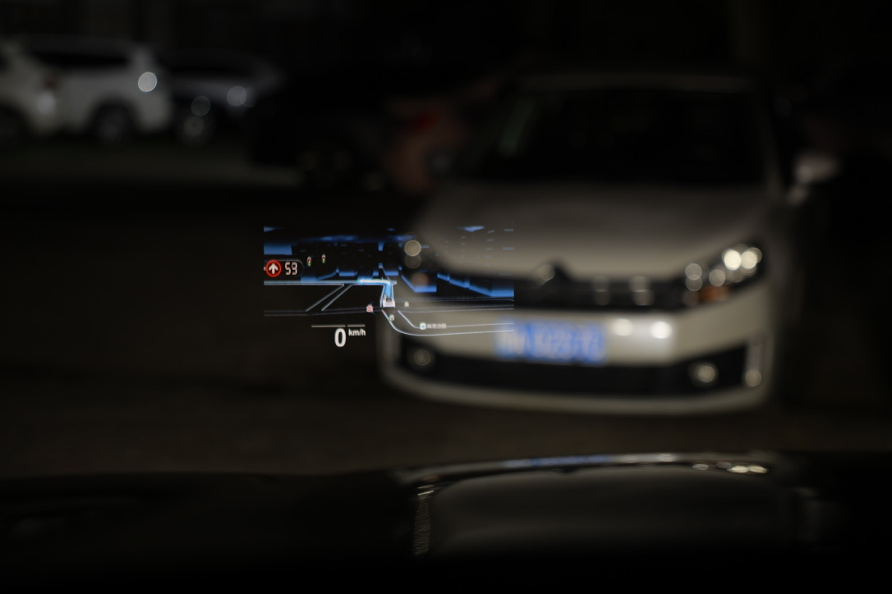

# 实车效果图 / On the owner's iDrive 7

[简体中文介绍](../README.zh-CN.md) · [English introduction](../README.md)

照片由 Wallezy 提供并用于本项目展示，来自同一次 iDrive 7 安装。它们记录可见结果，不作为全部车型、手机、地图应用的兼容性或帧率证明。图中的软件界面和地图内容保留各自权利人的标识；本项目整理安装与维护流程，上游项目实现具体功能。

Photos supplied by Wallezy document one iDrive 7 installation. They show observed
results, not compatibility or frame-rate measurements for other cars, phones or
map apps. Software and map branding remain visible. This project coordinates
setup and maintenance; the upstream projects implement the displayed features.

## 应用入口 / App entries

车机菜单可见“应用商店”和“Waze 仪表盘显示”入口。

The installed-apps menu shows entries for the Store and Waze on cluster.

## 应用商店 / Store

商店展示组件、应用及安装状态。照片里的可见条目属于拍摄时的源配置，不代表 OSS 镜像包含所有这些应用，也不代表所有条目均已安装。

The Store lists components, apps and installation states. The visible catalog
reflects the sources configured when photographed. It is not an inventory of
the OSS mirror, and a listed app is not necessarily installed.

## 仪表盘与 HUD 设置 / Cluster and HUD settings

仪表盘中可见地图，车机应用的“显示位置”菜单提供仪表盘、HUD、仪表盘和 HUD 三种选项；HUD 相关选项标为实验性。

The cluster shows a map. The app offers Cluster, HUD and Cluster and HUD as
display targets; the HUD choices are marked experimental.

## HUD 地图显示 / HUD map output

车辆停稳时拍摄的 HUD 地图实景。照片保留原始显示效果，没有生成或叠加导航画面；相机对焦、曝光与背景会影响照片观感，单张照片不能证明投流流畅度。

The photo shows map output on the HUD while parked. The navigation image is
photographed, not generated or composited. Focus, exposure and the background
affect the photo; a still image does not demonstrate streaming smoothness.

相关上游 / Related upstream projects:

- [mgu-store](https://github.com/robertnisipeanu/mgu-store)
- [idrive-apps](https://github.com/robertnisipeanu/idrive-apps)
